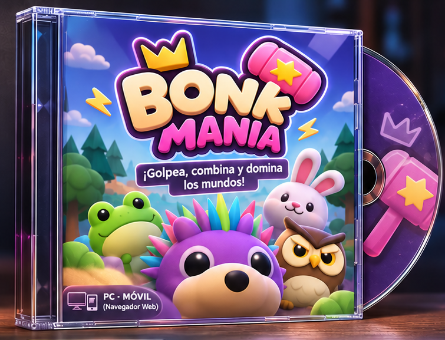

<div align="center">



# 🎮 BONK MANIA

### A colorful 3D arcade adventure!

**100 Levels · 10 Worlds · Cute Animals · Power-Ups · Electric Mines**


</div>

---

## 🌟 About the Game

**BONK MANIA** is a fun, colorful 3D arcade game featuring adorable animal characters, exciting challenges, and interactive gameplay.

Use your hammer to score points, activate special animal helpers, and switch to your electric magnet to defuse dangerous mines!

Explore 10 unique worlds across 100 increasingly challenging levels.

## 🕹️ Gameplay Screenshots

<div align="center">


</div>

## ✨ Features

- 🎯 **100 Levels** with progressive difficulty.
- 🌎 **10 Unique Worlds** with themed 3D environments.
- 🐸 **Animal Helpers** with special abilities.
- 🔨 **Interactive Hammer** for arcade gameplay.
- 🧲 **Electric Magnet** to defuse mines.
- 💣 **Mine Challenges** with countdown timers.
- ❤️ **Heart System** with damage and healing.
- ⭐ **Combos, Scores & Rewards**.
- 🎨 **Sticker Mania UI**, colorful and kid-friendly.
- 📱 **Responsive Design** for desktop and mobile.
- 🎮 **YouTube Playables SDK Integration** (testing).

## 🎮 Controls

| Action | Control |
|---|---|
| Hit animals | Left click |
| Switch tools | Right click |
| Alternative tool switch | Space |
| Defuse mines | Equip magnet + left click |
| Mobile | Touch controls |

## 🛠️ Built With

- HTML5
- CSS3
- JavaScript (ES6)
- Three.js
- Web Audio API
- YouTube Playables SDK

## 🚀 Getting Started

Clone the repository:

```bash
git clone https://github.com/YOUR-USERNAME/bonk-mania.git
cd bonk-mania
```

Start a local web server:

```bash
python -m http.server 8000
```

Open:

`http://localhost:8000`

An internet connection may be required for external dependencies.

## 📺 YouTube Playables

BONK MANIA is being prepared for YouTube Playables.

Current development priorities include:

- SDK compatibility testing
- Local dependency packaging
- Mobile performance optimization
- Content Security Policy validation
- Final gameplay quality assurance

**Note:** This project is not yet certified or published on YouTube Playables.

## 📁 Project Structure

```text
bonk-mania/
├── index.html
├── config.js
├── assets/
├── docs/
│   └── images/
│       ├── cover.png
│       ├── gameplay-01.png
│       ├── gameplay-02.png
│       ├── gameplay-03.png
│       └── gameplay-04.png
└── README.md
```

---

<div align="center">

### ⭐ BONK MANIA

**BONK · SCORE · SURVIVE!**

Made with ❤️ for arcade game lovers.

</div>
